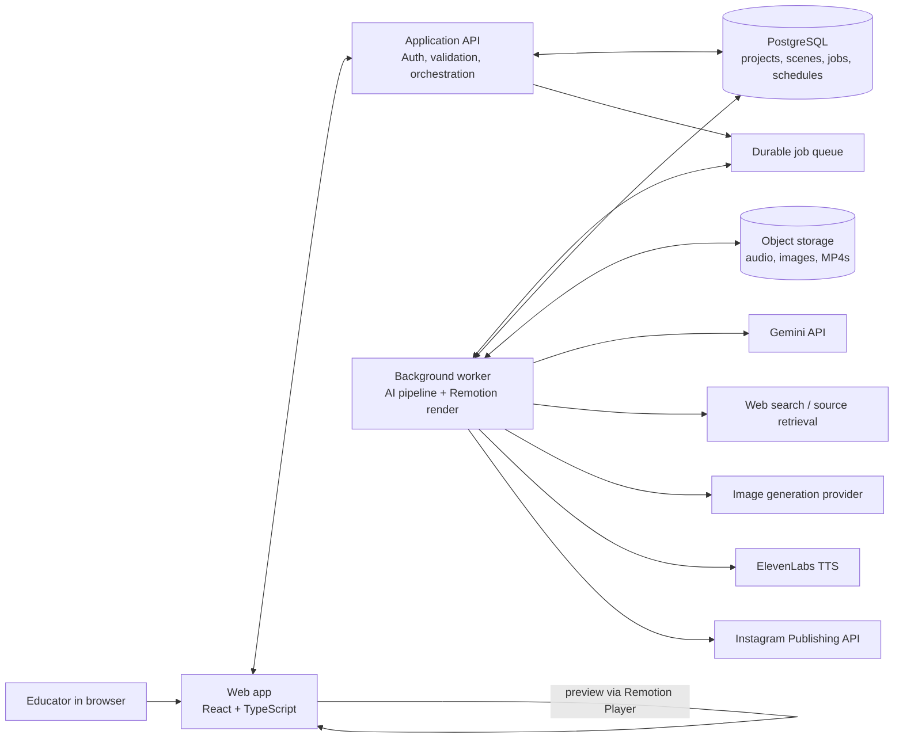

# AI Educational Video Maker — Architecture Proposal

**Status:** Proposed, for a learning project  
**Related product spec:** [PRD.md](PRD.md)

## 1. Architecture goals

- Keep the end-to-end path easy to understand while learning each AI integration.
- Keep slow model calls and video rendering out of normal web requests.
- Make every generation step visible, resumable, and retryable.
- Let a creator review content before expensive production and approve the final video before publishing.
- Keep provider integrations replaceable so the app is not tightly coupled to one model vendor.

## 2. Recommended shape

Start with a **modular monolith**: one TypeScript repository, a web app, and a separate background worker. Split into services only if usage later requires it.



### Suggested implementation stack

| Area | Recommendation | Why |
|---|---|---|
| App | Next.js + React + TypeScript | The UI and server endpoints can live together; React works naturally with Remotion. |
| Video composition | Remotion + Remotion Player | Reusable React scenes can be previewed in the app and rendered to a video file. |
| Database | PostgreSQL | Stores projects, scene structure, generation status, connected accounts, and scheduled posts. |
| File storage | S3-compatible object storage | Holds generated audio, illustrations, music, covers, and rendered MP4s. |
| Background work | A durable queue and Node.js worker | Model calls and rendering can take longer than a web request and need progress and retries. |
| Providers | Gemini API for script/storyboard generation; small TypeScript interfaces around source search, image, TTS, and publishing APIs | Provider details can change without rewriting the project workflow. |

For the first learning pass, run the web app and worker on the user's machine. Keep the queue/job boundary from the beginning, then move the worker and storage to hosted services when deployment is needed. Add a `.env.example`; keep actual provider keys in a local, git-ignored `.env` file.

## 3. Main modules

### A. Project studio

- Create and reopen projects/drafts.
- Collect idea, audience (`kids`, `teens`, `adult beginners`), duration (`30`, `45`, `60` seconds), narration voice, and tone (`friendly`, `energetic`, `calm`).
- Display script, source references, claims needing review, and editable storyboard scenes.
- Show each generation step and its status.

### B. Lesson generation

1. Source retrieval obtains candidate references for the topic.
2. Gemini API receives the topic, audience, duration, and retrieved sources.
3. It returns one structured script/storyboard object, with sources attached to relevant factual claims and uncertain claims flagged.
4. Validate the response against a JSON schema before saving it. If invalid, repair or retry the response rather than passing malformed data to the renderer.
5. The user edits and approves the storyboard before production.

The model must cite only retrieved sources supplied to it. Store source title, URL, retrieval time, and the claims supported by that source. Flag unsupported factual claims rather than inventing a citation.

### C. Asset generation

- Generate an illustration for each scene using a shared style prompt, palette, and character/style description.
- Store each illustration as a scene asset with provider/model metadata and generation prompt version.
- Regenerate only the selected scene while preserving the shared style instructions.
- Generate the Reel cover from the final lesson title and use the result as-is in v1.
- Generate narration with the chosen voice and tone. Store the audio and its metadata.
- Produce caption timing from the narration transcript/alignment step and associate caption cues with scene timing.

### D. Remotion composition and rendering

- Treat the approved storyboard as serializable `inputProps` for a Remotion composition.
- Build reusable scene templates (hook, explanation, example/visual, recap) rather than making every scene an unrelated component.
- Calculate scene durations from narration timing, then place illustration motion, captions, narration, and low-volume music on the same timeline.
- Use Remotion Player for in-app preview.
- Render the final vertical MP4 in a background worker and upload it to object storage.
- Save a render version so a later edit does not overwrite the approved version unexpectedly.

### E. Instagram publishing and calendar

- Connect an Instagram account through Meta's supported authorization flow.
- Keep access tokens encrypted server-side; never send provider tokens to the browser.
- Store schedule time and post content in the database, then enqueue a publish job for the due time.
- The publishing worker uploads the video, creates/publishes the post, records the platform response, and updates status.
- Use idempotency keys and persisted states to prevent duplicate posts after a timeout or retry.
- Alert the user when publishing fails and allow an explicit retry.
- Retain MP4 download as a separate user action.

Meta's publishing integration has account and media requirements that must be verified against the current platform documentation during implementation. In particular, Meta's official Instagram Login materials describe access for professional accounts (businesses and creators), and the publishing flow must be implemented with its current permissions and media-hosting requirements. See [Meta Instagram API collection](https://www.postman.com/meta/instagram/folder/6raa77c/instagram-api-with-instagram-login) and [Instagram publishing documentation](https://developers.facebook.com/docs/instagram-platform/content-publishing).

## 4. Generation workflow and state

Use an explicit state machine so the UI can resume work and the worker can retry safely:

```text
draft
  -> script_generating -> script_review
  -> assets_generating -> assets_ready
  -> narration_generating -> narration_ready
  -> render_queued -> rendering -> rendered
  -> user_approved
  -> scheduled -> publishing -> published
                              \-> publish_failed -> retry queued
```

Generation, rendering, and publishing jobs should each have:

- A stable job ID and owning project/version.
- `queued`, `running`, `succeeded`, and `failed` states.
- Attempt count, last error (safe for display), start/end time, and progress metadata.
- A retry policy for transient provider or network errors.
- Idempotent writes so retrying an operation does not create duplicate assets or posts.

## 5. Initial data model

| Entity | Important fields |
|---|---|
| `User` | id, display name, created at |
| `Project` | id, user id, topic, audience, duration, language, status, created/updated at |
| `ProjectVersion` | id, project id, version number, approved script/storyboard JSON |
| `Scene` | id, version id, sequence, narration text, on-screen text, visual prompt, duration, review flags |
| `Source` | id, version id, title, URL, retrieved at, excerpt/metadata |
| `ClaimSource` | scene/claim id, source id, support status |
| `Asset` | id, project/version/scene id, type, storage key, provider, generation metadata |
| `GenerationJob` | id, project/version id, type, status, attempts, error, timestamps |
| `SocialAccount` | id, user id, provider, platform account id, encrypted token reference, token expiry |
| `ScheduledPost` | id, project/version id, social account id, scheduled time, caption, hashtags, status, platform post id |

Keep API secrets in server-side environment/secret storage. Store token references or encrypted values, not plain access tokens in general-purpose logs or browser state.

## 6. Suggested API boundary

Representative application operations (names can change):

- `POST /api/projects` — create a draft.
- `POST /api/projects/:id/script` — enqueue source retrieval and script/storyboard generation.
- `PATCH /api/projects/:id/storyboard` — save creator edits and create a new version.
- `POST /api/scenes/:id/illustration` — generate or regenerate one scene illustration.
- `POST /api/projects/:id/narration` — create narration for the approved script.
- `POST /api/projects/:id/render` — enqueue Remotion rendering.
- `POST /api/projects/:id/schedule` — schedule an approved render and post text.
- `GET /api/jobs/:id` — read job state/progress.
- `GET /api/calendar` — list scheduled posts.
- `POST /api/posts/:id/retry` — retry a failed publishing job.

The browser should call application endpoints only. The backend owns AI provider keys, Instagram tokens, authorization checks, and storage permissions.

## 7. Build sequence

### Phase 1 — Learn the video loop locally

- Scaffold the React/Remotion project.
- Create a fixed playful-doodle composition with editable scene data.
- Render a sample 30-second MP4 locally.

### Phase 2 — Add AI lesson planning

- Add topic, audience, and duration input.
- Generate schema-validated script/storyboard with retrieved source references.
- Add editable scene review and draft persistence.

### Phase 3 — Add voice and visuals

- Connect ElevenLabs and the selected image-generation provider.
- Generate scene illustrations, narration, captions, and background mix.
- Add per-scene illustration regeneration and preview.

### Phase 4 — Make rendering a reliable job

- Move rendering to a background worker.
- Track progress and failures; upload versioned MP4s to object storage.
- Support download and resume from drafts.

### Phase 5 — Add Instagram publishing

- Implement account authorization and token handling.
- Add scheduled-post calendar, publisher worker, status, failure alert, and retry.
- Verify account eligibility, permissions, and media requirements using current Meta docs before enabling live publishing.

## 8. Key architectural decisions still open

- Which search/retrieval and image-generation providers to use.
- Local development is the first deployment target; hosted deployment comes later.
- Which local database and local asset-storage approach to use before moving to managed services.
- Which specific ElevenLabs voices to include in the curated starter list.
- How much reference retrieval and claim-support checking to implement for the learning prototype.

## 9. Risks and mitigations

| Risk | Mitigation |
|---|---|
| A generated explanation contains an unsupported claim | Attach retrieved sources to claims; flag unsupported items; require creator review before production. |
| Scene visuals drift from the selected doodle style | Reuse a style guide, palette, and reference image; store prompts and regenerate one scene at a time. |
| Provider calls are slow, costly, or fail | Run each step as a job; expose progress; retry transient failures; cache completed assets by version. |
| Caption timing does not match voice | Derive cues from actual generated narration timing, not only script word counts. |
| A retry creates duplicate Instagram posts | Persist publish state and use idempotent job transitions; reconcile uncertain outcomes before retry. |
| Publishing access is more constrained than expected | Build and validate a local MP4 export path before Meta authorization is ready. |
